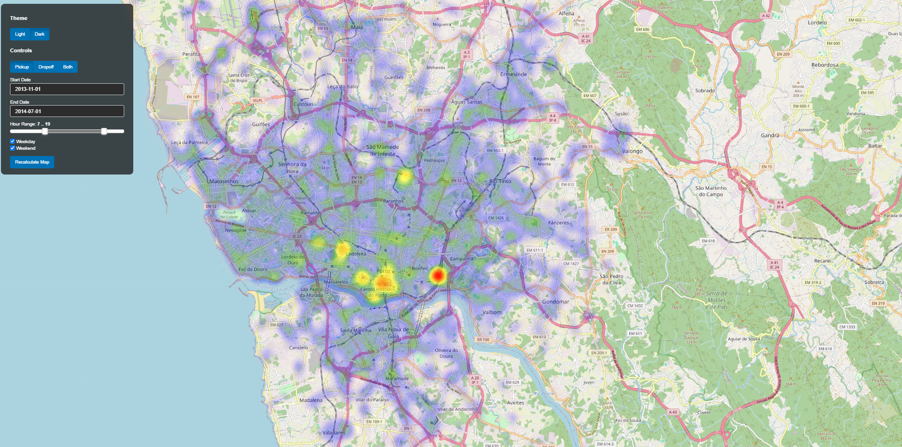

# Porto Taxi Heatmap

Interactive visualization of taxi pickup and drop-off activity in Porto, Portugal. The main application is built with [Panel](https://panel.holoviz.org/), [Folium](https://python-visualization.github.io/folium/) and PostgreSQL/PostGIS.



## Features

- Interactive pickup, drop-off and combined heatmaps
- Date and hour filtering
- Weekday/weekend filtering
- Light and dark map controls
- Grid tooltips showing the number of trips in dense areas
- PostgreSQL/PostGIS-backed queries for filtering and aggregation

## Project structure

```text
.
├── presentation/
│   ├── app.py          # Main Panel web application
│   ├── database.py     # PostgreSQL queries
│   ├── widgets.py      # User-interface controls
│   ├── config.py       # Environment-based configuration
│   ├── setup.sql       # Creates the trip_simple table and indexes
│   └── styles.css      # Application styling
├── demo/               # Earlier map and clustering prototypes
├── postGisClustering/  # Earlier Panel/PostGIS experiments
├── get_porto_routes.py # Downloads Porto roads from OpenStreetMap
├── display_porto_roads.py
├── plot_trips.py       # Plots sample trip trajectories
└── requirements.txt
```

## Requirements

- Python 3.10 or newer
- PostgreSQL with the PostGIS extension
- A database containing the original `trip` table
- The `trip` table must contain at least `trip_id`, `start_time` and `polyline_json` (a JSON/JSONB array of `[longitude, latitude]` coordinates)

## Installation

From the project root in PowerShell:

```powershell
py -m venv venv
.\venv\Scripts\Activate.ps1
python -m pip install --upgrade pip
pip install -r requirements.txt
```

If PowerShell blocks activation, run this once:

```powershell
Set-ExecutionPolicy -Scope CurrentUser RemoteSigned
```

## Configuration

Set the database connection before starting the app:

```powershell
$env:POSTGRES_DB = "taxis_porto"
$env:POSTGRES_USER = "postgres"
$env:POSTGRES_PASSWORD = "your_database_password"
$env:POSTGRES_HOST = "127.0.0.1"
$env:POSTGRES_PORT = "5433"
```

Never commit a real password, API key or `.env` file to GitHub. The app uses OpenStreetMap tiles by default and does not require a map API key. CARTO can optionally be enabled with `$env:CARTO_API_KEY`.

## Database setup

The main app expects a simplified table named `trip_simple`. Create it once after the original `trip` table is available:

```powershell
psql -h 127.0.0.1 -p 5433 -U postgres -d taxis_porto -f presentation/setup.sql
```

Alternatively, execute `presentation/setup.sql` in pgAdmin. It extracts pickup/drop-off points, calculates weekday/weekend information and creates indexes for faster filtering.

## Run the main application

Run the server from the `presentation` directory:

```powershell
cd presentation
..\venv\Scripts\Activate.ps1
panel serve app.py --show --autoreload
```

Open `http://localhost:5006/app` in your browser. Stop the server with `Ctrl+C`.

## Other scripts

Earlier prototypes are stored in `demo/` and `postGisClustering/`. For example:

```powershell
cd postGisClustering
panel serve heatmap_v3.py --show --autoreload
```

Generated HTML examples are available in `demo/maps/` and `postGisClustering/`.

## GitHub safety checklist

Before pushing, check that no credentials are staged:

```powershell
git status
git diff --cached
```

The repository ignores virtual environments, Python cache files, local environment files and generated local output. Add the appropriate license and dataset attribution before making the repository public.
